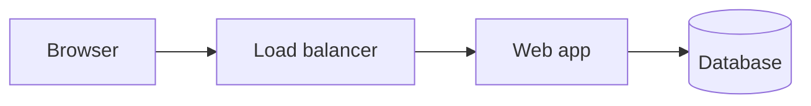

Diagrams as code means describing a diagram in a plain-text format, which a tool renders into a picture. Mermaid and PlantUML are two common choices. The diagram source lives in the repository next to the code, so it can be reviewed, diffed and updated in the same change as the system it describes.

A flowchart in Mermaid is a few lines of text:

The same file produces a rendered image wherever the tool runs, including in many code hosting services that render Mermaid blocks directly in Markdown.

The trade-off is control against polish. Text diagrams are easy to keep current and easy to review, but automatic layout can produce crowded or awkward arrangements that a hand-drawn picture would avoid. Complex diagrams may need explicit layout hints, and the text can become hard to read when the diagram is large.

The classic mistake is treating the text as a throwaway and drawing the picture by hand in a separate tool, so the two drift apart. Keep one source, render it in the build or in the hosting service, and keep diagrams small enough that the text still reads well. For the broader idea of keeping documentation alongside the code, see [docs as code](/t/docs-as-code).
