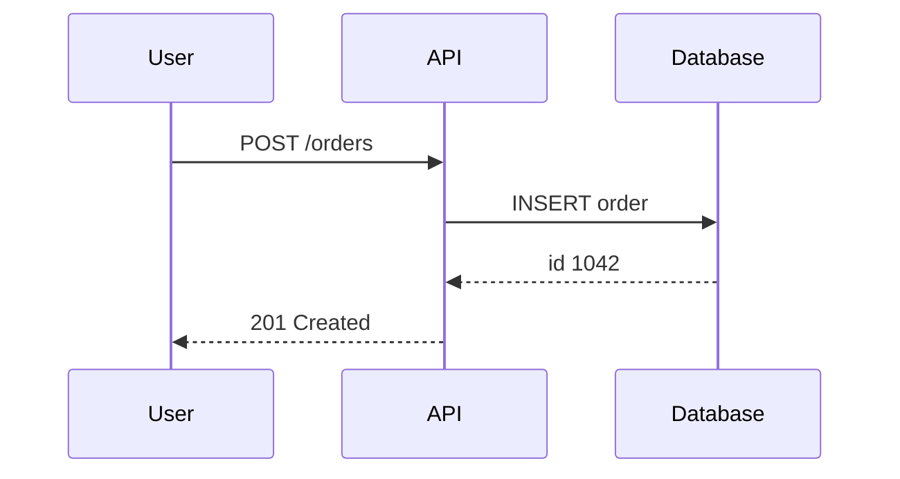

A sequence diagram shows the messages exchanged between participants over time. Each participant has a vertical lifeline, and each message is an arrow from one lifeline to another, read from top to bottom. It's the best way to show the order of calls in a single flow, such as a request through several services.

Here is a request that creates an order, written in Mermaid:

Solid arrows are requests, and dashed arrows with an open head are responses. The diagram answers "what happens, and in what order" for one scenario.

The trade-off is that a sequence diagram shows one path. A flow with many branches needs several diagrams, or a flowchart for the decisions. Diagrams of long flows become tall and hard to scan, so keep each one to a single scenario.

The classic mistake is drawing the happy path and leaving out the failures that matter most, such as a timeout or a retry. Add those as alternative branches or as a separate diagram, since the failure order is often where the design is weakest. For a diagram of states rather than messages, see the [state diagram](/t/state-diagram).
