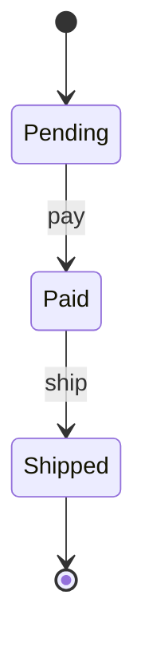

A state diagram shows the states an object can be in, and the events that move it from one state to another. States are drawn as boxes, transitions as arrows labelled with the event that causes them, and a start marker shows the initial state.

Reading it: an order starts as pending, becomes paid when the payment event occurs, becomes shipped, and then ends. The diagram doesn't show a transition that isn't drawn, such as shipping an unpaid order, which makes missing transitions easy to spot.

The trade-off is that state diagrams get large when many events and conditions interact, and the drawing can hide conditions on the transitions. A diagram shows the shape of the logic, but not the data that decides a transition unless you label it.

The classic mistake is drawing the diagram after the code, so it records what was built rather than what was intended, or leaving out error and cancel states that real systems need. Draw the diagram during design, and check it against the code and its tests. The same states and transitions are often implemented as a [finite state machine](/t/finite-state-machine) or with the [state pattern](/t/state-pattern).
